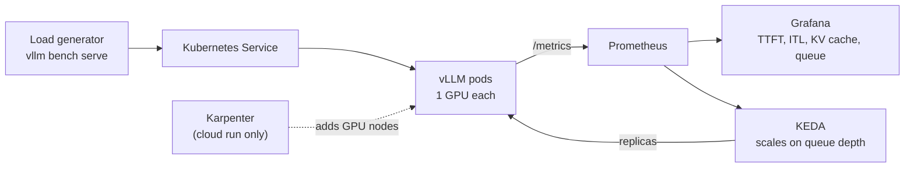
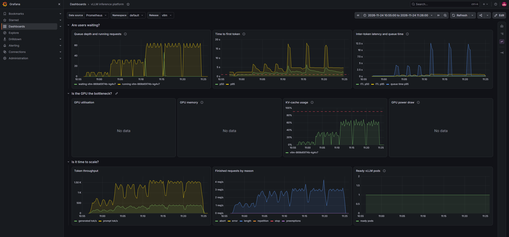

# llm-inference-platform

Production-style LLM serving on Kubernetes with vLLM: autoscaling on queue depth, real observability, and published latency and cost benchmarks.

Built by an infrastructure and security engineer, as a secure, observable, production-grade AI serving platform. `make up-local` brings it up on a local k3s cluster with one command; `make up-cloud` deploys the same chart to AWS EKS.

**Status:** Week 3 of 3; the platform ships Fri 27 Nov. Running on k3s (laptop GPU) and, on 24 Nov, once on AWS EKS with an NVIDIA L4 launched by Karpenter, from the same Helm chart, with the same benchmark script on both. Prometheus/Grafana monitoring with three tested alerts, KEDA queue-depth autoscaling, and Terraform with cost guardrails are in. [Results](#benchmark-laptop-rtx-5080-vs-cloud-l4-24-nov). Built in public; progress is logged below.

## Why this exists

Most LLM serving demos stop at `vllm serve` on one GPU. Production serving is an infrastructure problem: scheduling GPUs, scaling on the right signal, knowing when users are waiting, and knowing what each token costs. This project treats LLM inference like any other production service, with reproducible infrastructure, metrics that matter and honest benchmarks.

## Approach: local first, cloud once

- **Weeks 1–2, local:** an RTX 5080 Laptop GPU (16 GB) under WSL2, running k3s, the same Helm chart and the same monitoring stack. Free iteration on real hardware.
- **Week 3, cloud:** one short Terraform-provisioned run on AWS EKS with an NVIDIA L4, using the **same Helm chart**. It proves portability and node autoscaling, and it gives a measured cost per 1M tokens.
- **Model:** [Qwen3-8B-FP8](https://huggingface.co/Qwen/Qwen3-8B-FP8) (Apache-2.0) as the primary model, and Qwen3-1.7B for fast iteration.
- **Engine:** vLLM, pinned to an exact release (currently `v0.33.0`).

## Architecture (target)



Scaling is driven by `vllm:num_requests_waiting` (queue depth), not GPU utilisation. A busy GPU is normal; a growing queue is what users feel.

## Run it today

Prerequisites: WSL2 (Ubuntu 24.04) with systemd, or Linux; Docker Engine; the NVIDIA Container Toolkit; Helm; make (`sudo apt install make`).

**On Kubernetes (k3s), the normal path:**

```bash
make k3s-install     # one time; then: export KUBECONFIG=/etc/rancher/k3s/k3s.yaml
make monitoring-up   # one time: kube-prometheus-stack + GPU exporter
make keda-up         # one time: KEDA, for the autoscaling demo
make up-local        # device plugin, image import, helm upgrade --install charts/vllm, wait for Ready
make smoke-local     # port-forward + one completion
make grafana         # dashboard at http://localhost:3000
make alert-test ALERT=ttft   # force an alert to fire (ttft | queue | idle), then restore
make up-local KEDA=1 && make scale-test   # demo: 2 replicas on one GPU, watch 1 -> 2 -> 1
make down-local      # remove the release (k3s and the caches stay)
make help            # every target
```

Details and what broke on the way: [`platform/k3s/`](platform/k3s/README.md); chart values: [`charts/vllm/`](charts/vllm/README.md).

**In plain Docker, on one GPU:**

```bash
# Serve Qwen3-8B-FP8 (the first run downloads about 9 GB of weights into ~/.cache/huggingface)
docker run --rm --gpus all --ipc=host -p 8000:8000 \
  -v ~/.cache/huggingface:/root/.cache/huggingface \
  -v ~/.cache/vllm:/root/.cache/vllm \
  vllm/vllm-openai:v0.33.0 \
  --model Qwen/Qwen3-8B-FP8 --max-model-len 8192 --gpu-memory-utilization 0.85

# Once the weights are cached, add -e HF_HUB_OFFLINE=1 after --ipc=host to skip Hugging Face network checks.

# Check it answers
curl -s localhost:8000/v1/chat/completions -H "Content-Type: application/json" \
  -d '{"model":"Qwen/Qwen3-8B-FP8","messages":[{"role":"user","content":"Hello"}],"chat_template_kwargs":{"enable_thinking":false}}'

# Load test (from a second terminal)
docker exec -it $(docker ps -q --filter ancestor=vllm/vllm-openai:v0.33.0) vllm bench serve \
  --model Qwen/Qwen3-8B-FP8 --dataset-name random --random-input-len 512 --random-output-len 128 \
  --num-prompts 100 --max-concurrency 8

# Measure cold start (starts and stops its own container)
OFFLINE=1 bench/coldstart.sh my-run Qwen/Qwen3-8B-FP8 --max-model-len 8192 --gpu-memory-utilization 0.85
```

## Roadmap

- [x] vLLM serving an open-weight model on a local GPU (WSL2, RTX 5080 Laptop)
- [x] Qwen3-8B-FP8 serving, with KV-cache capacity measured on 16 GB
- [x] Cold start cut from about 35 min to about 2.3 min (weight and compile caches); upstream vLLM data and fix validation ([#54383](https://github.com/vllm-project/vllm/issues/54383), [PR #54479](https://github.com/vllm-project/vllm/pull/54479))
- [x] k3s on WSL2 with the GPU scheduled by the NVIDIA device plugin ([`platform/k3s/`](platform/k3s/README.md))
- [x] Helm chart ([`charts/vllm/`](charts/vllm/README.md)) with `make up-local` / `make down-local` / `make smoke-local`
- [x] Prometheus/Grafana dashboard (TTFT, inter-token latency, throughput, KV-cache usage, queue depth, GPU utilisation) and three alerts, each fired in a forced test ([`platform/monitoring/`](platform/monitoring/README.md))
- [x] Autoscaling on queue depth with KEDA: 1 → 2 → 1 replicas on one time-sliced GPU, tested with `make scale-test` ([`platform/autoscaling/`](platform/autoscaling/README.md))
- [x] Terraform for the cloud run: VPC, EKS, Karpenter, Pod Identity, S3 weights bucket; budget and cost guardrails in a separate stack that outlives the cluster ([`infra/terraform/`](infra/terraform/README.md), [`infra/billing/`](infra/billing/README.md), [runbook](docs/cloud-run.md))
- [x] One AWS EKS run (24 Nov): same chart, Karpenter adds an L4 node from zero and removes it when idle, cold-start breakdown, destroyed and checked for leftovers
- [x] Repeated benchmarks with one script (`bench/run.sh`) on the laptop and on EKS: laptop vs L4, cost per 1M output tokens
- [ ] (Fri 27 Nov) Benchmark write-up and final README

## Benchmark: laptop RTX 5080 vs cloud L4 (24 Nov)

Same model (Qwen3-8B-FP8), same vLLM image (`v0.33.0`), same Helm chart, same script: [`bench/run.sh`](bench/run.sh)
runs `vllm bench serve` as a Job on the server's node, with random 512-token prompts and 128 output tokens, a
50-prompt warm-up that is discarded, then **3 runs per concurrency level**, reported as median [min–max]. 0 failed
requests. Raw runs, conditions and logs: [laptop](bench/results/serve/20261123T0522Z-k3s/), [L4](bench/results/serve/20261124T0526Z-g6.xlarge/).

| Concurrent requests | Laptop RTX 5080 (16 GB) | Cloud L4 (24 GB, g6.xlarge) | L4 TTFT p50 / p99 | L4 $ per 1M output tokens* |
|---|---|---|---|---|
| 8 | 396 tok/s [395–398] | 158 tok/s [158–180] | 0.96 s / 1.6 s | $1.42 |
| 32 | 1,006 tok/s [1,005–1,010] | 326 tok/s [324–327] | 2.0 s / 6.0 s | $0.69 |
| 64 | 1,077 tok/s [1,075–1,079] | 381 tok/s [381–385] | 2.6 s / 12.0 s | $0.59 |

\* g6.xlarge on-demand, us-east-1, $0.8048/h, GPU node only and fully loaded. Cluster overhead (EKS control plane,
two system nodes, NAT) adds about $0.32/h while the cluster is up.

What the numbers say:

- **The L4 delivers 35–40% of the laptop GPU's throughput**, close to their memory-bandwidth ratio (300 GB/s vs
  896 GB/s): generating tokens is mostly reading weights and KV cache from GPU memory.
- **The latency target sets the price.** $0.59 per 1M tokens needs 64 requests in flight, where p99 time to first
  token is 12 s. Near a ~1 s first-token target only concurrency 8 qualifies, at $1.42, 2.4× the price.
- **Both GPUs saturate early.** The laptop gains 7% from 32 to 64 concurrent while median TTFT nearly quadruples;
  past that point extra users mostly wait in the queue, which is why the platform scales on queue depth.
- **The L4 ran at its 72 W power cap.** `nvidia-smi` after the run counted 25 min of software power capping during
  the ~30 min benchmark and no thermal slowdown. At concurrency 8 the first run was faster (180 tok/s, TTFT p50
  0.30 s) than the next two (158 tok/s, 0.96 s); power capping is the likely cause, but the counter is cumulative,
  so it can't be tied to that run.

### Cloud run (EKS, 24 Nov)

| | |
|---|---|
| Provisioned | `terraform apply`: 97 resources (VPC, EKS 1.34, Karpenter, Pod Identity, S3 endpoint), ~20 min |
| GPU node | Karpenter launched a g6.xlarge 3–14 s after the pod was pending; removed ~5 min after vLLM was (scale to zero tested) |
| Cold start (twice) | **650 s and 646 s**: node ready 51 s, weights from S3 8.9 GB in 60 s, vLLM image pull ~335 s, model load ~200 s |
| Teardown | `make cloud-teardown` (drains the GPU node first), `terraform destroy` 97, `make cloud-leftovers` clean |
| Cost | ~$2.75 estimated: cluster ~5.8 h (~$1.87) + GPU 1.07 h from CloudTrail ($0.86); actual bill to be added from Cost Explorer |



The image pull is half the cloud cold start; it is the next thing to cut. Guardrails used: a project budget that
counts only tagged costs and survives `destroy`, an account-wide backstop, a live cost estimate, and a leftovers
check ([runbook](docs/cloud-run.md)).

## Week 1 baseline (superseded by the benchmark above)

Single run, no warm-up, kept for the record.

Hardware: RTX 5080 Laptop GPU (16 GB), Windows 11 + WSL2 (Ubuntu 24.04). Stack: vLLM `v0.33.0` (Docker), NVIDIA Container Toolkit 1.20.1, `--gpu-memory-utilization 0.85`. Workload: random 512 input / 128 output tokens, 100 prompts, concurrency 8.

| | Qwen3-1.7B (BF16) | Qwen3-8B-FP8 |
|---|---|---|
| Max model length | 4,096 | 8,192 |
| Weights in GPU memory | 3.22 GiB | 8.85 GiB |
| KV cache | 9.17 GiB, 85,824 tokens | 2.89 GiB, 21,024 tokens |
| Full-length requests that fit at once | about 21 | 2.57 |
| Throughput | 6.57 req/s, 840.6 output tok/s | 2.92 req/s, 373.8 output tok/s |
| TTFT | median 147.7 ms, p99 405.8 ms | median 308.5 ms, p99 495.8 ms |
| Inter-token latency | median 7.48 ms, p99 29.5 ms | median 17.9 ms, p99 54.5 ms |
| vLLM engine init, first start (vLLM's internal timer) | 103 s | 151 s |

The early takeaway: on 16 GB, the 8B model's weights leave under 3 GiB for KV cache, so long-context concurrency, not compute, will be the first wall.

Engine init is vLLM's own timer for memory profiling, KV-cache allocation and warm-up. It excludes container start, weight download and loading, and API server start, so it is shorter than the wall-clock "ready" times in the cold-start table below, which come from separate runs on 10 Nov.

### Cold start (Qwen3-8B-FP8): 35 minutes to about 2.3 minutes

Measured with [`bench/coldstart.sh`](bench/coldstart.sh): wall-clock time from `docker run` until `/health` returns 200, Qwen3-8B-FP8, same flags every run. Raw logs and `results.jsonl` are in [`bench/results/coldstart/`](bench/results/coldstart/). For comparison, the smaller Qwen3-1.7B took about 14.5 min on its first start, 12.9 min of it weight download (9 Nov log).

| Run | Ready | Weight download | Weight load | torch.compile | Engine init |
|---|---|---|---|---|---|
| First start, nothing cached (Qwen3-8B-FP8, 9 Nov log, approximate) | about 35 min | 1,981 s | 1.3 s | 20.7 s | 151 s |
| Weights cached on local disk | 212 s | none | 5.2 s | 21.2 s | 147 s |
| + offline mode (`HF_HUB_OFFLINE=1`), compile cache filling | 153 s | none | 1.5 s | 21.0 s | 116 s |
| + compile cache hit (run 1) | **135 s** | none | 1.2 s | 0.16 s | 95 s |
| + compile cache hit (run 2) | **145 s** | none | 5.0 s | 0.17 s | 93 s |

What changed:

- **Weights cached on local disk** (`~/.cache/huggingface` mounted into the container) removed the download, which was 95% of the original cold start.
- **Compile cache persisted** (`~/.cache/vllm` mounted) cut torch.compile from 21 s to under 0.2 s. It hit on the second offline run, not the first, which suggests the offline setting is part of the cache key.
- **What remains (about 93 s)** is engine initialisation, mostly CUDA graph capture, which is not cached. In production that floor is handled with warm replicas or fewer captured graph sizes.

Side finding: with the compile cache hit, vLLM's startup memory profiling measured a lower peak activation (0.92 GiB instead of 1.58 GiB), so the KV cache grew from 21,024 to 25,824 tokens with identical flags and identical free memory (14.61 GiB). Capacity can change between restarts, so benchmarks will pin `--kv-cache-memory` explicitly.

This is open vLLM issue [#54383](https://github.com/vllm-project/vllm/issues/54383): torch.compile's temporary memory on a cold boot is counted as activation memory. On this 16 GB card the gap was 22.8%, against about 4–5% in earlier reports, so I added that data point to the issue. I then validated the proposed fix, [PR #54479](https://github.com/vllm-project/vllm/pull/54479), on v0.33.0: the patched cold boot got 25,824 tokens and 0.92 GiB peak activation, matching the warm boot, for about 3–6 s of extra engine init. Logs: `*-unpatched-cold.log`, `*-pr54479-cold.log` and `*-pr54479-warm.log` in [`bench/results/coldstart/`](bench/results/coldstart/).

## Layout


```
├── Makefile                 # built: up-local/down-local/smoke-local, monitoring, alert-test, bench, up-cloud/down-cloud/bench-cloud/cloud-teardown
├── infra/terraform/         # built, applied once (24 Nov) and destroyed: VPC, EKS, Karpenter, Pod Identity, S3 gateway endpoint
├── infra/billing/           # built, applied: $20 project budget (by tag), account backstop, S3 weights bucket; outlives the cluster
├── infra/scripts/           # built: cloud-preflight, cloud-cost (live estimate), cloud-timeline, cloud-leftovers
├── platform/eks/            # built: Karpenter GPU NodePool (g6.xlarge, on-demand)
├── charts/vllm/             # built: Helm chart, values-local.yaml, values-cloud.yaml, ServiceMonitor, alerts, dashboard JSON
├── platform/k3s/            # built: GPU smoke test, NVIDIA device plugin
├── platform/monitoring/     # built: kube-prometheus-stack + GPU exporter values, alert-test script
├── platform/autoscaling/    # built: scale-test (in-cluster load, KEDA 1 -> 2 -> 1)
├── bench/                   # benchmark runner + raw results (never edited by hand)
└── docs/                    # architecture, decision records
```

## Progress log

- **2026-11-24:** Cloud run on EKS (us-east-1): Terraform applied 97 resources; Karpenter launched an L4 (g6.xlarge) for the pending vLLM pod and removed it when idle; weights came from S3 through Pod Identity (only the `vllm` service account can read the bucket). Cold start 650 s, half of it the image pull. Benchmark with the same script as the laptop: 158 / 326 / 381 tok/s at 8 / 32 / 64 concurrent, $1.42 / $0.69 / $0.59 per 1M output tokens. Preflight caught a home IP change before apply. Destroyed and checked for leftovers.
- **2026-11-23:** Cost guardrails before any cloud spend: budget and weights bucket moved to their own Terraform stack so `destroy` keeps the alarm; the budget counts only `project`-tagged costs; `make cloud-preflight` / `cloud-cost` / `cloud-leftovers`. Benchmark script `bench/run.sh` (warm-up, 3 repeats per level): laptop 396 / 1,006 / 1,077 tok/s at 8 / 32 / 64 concurrent, replacing the week-1 single run.
- **2026-11-20:** Same-GPU replica benchmark (3 runs each): two replicas sharing one GPU were 48% slower at 64 concurrent and unstable at 256; one replica with the whole GPU was best, so `make up-local` now defaults to that and the 2-replica KEDA setup is an opt-in demo (`KEDA=1`). Shared on [vllm#60599](https://github.com/vllm-project/vllm/issues/60599#issuecomment-7044806100).
- **2026-11-17:** KEDA scales vLLM on `sum(vllm:num_requests_waiting)` (5 per replica, 1–2 replicas); the NVIDIA device plugin time-slices the GPU into 2, and each pod gets 0.4 of the GPU plus a pinned 1.5 GiB KV cache. `make scale-test` (512 concurrent, in-cluster): KEDA asked for 2 replicas 12 s after load started, the second pod was Ready about 2.5 min later, and it scaled back to 1 about 2 min after the queue emptied. Finding: on one shared GPU the second replica did not raise throughput (the GPU was already at 100% and each KV cache filled), so it proves the scaling loop, not extra capacity; that needs a second GPU (the cloud run's 4 vCPU G/VT quota allows one GPU node, so it shows Karpenter adding a GPU node from zero and removing it, not a second node). Terraform for VPC, EKS, Karpenter, S3 and budget alerts passes `terraform plan` (not applied).
- **2026-11-16 (pm):** Monitoring: `make monitoring-up` installs kube-prometheus-stack and nvidia_gpu_exporter; the vLLM chart adds a ServiceMonitor, three alerts and a Grafana dashboard. `make alert-test` forced each alert to fire (TTFT SLO, out of capacity at max replicas, idle GPU). WSL2 fixes: node-exporter's root mount propagation, and Prometheus queries through a short port-forward.
- **2026-11-16:** Helm chart `charts/vllm` replaces the plain manifests; `make up-local` runs preflight checks, deploys the NVIDIA device plugin, imports the pinned image from Docker into k3s and installs the release. Cache paths come from `$HOME` instead of being hard-coded; `enableServiceLinks: false` is built into the chart.
- **2026-11-12:** Plan compressed after week 1 ran ahead: the platform now ships Fri 27 Nov (was 11 Dec); the cloud run moves to week 3.
- **2026-11-11:** vLLM serving on k3s (WSL2) with the GPU scheduled by NVIDIA device plugin v0.20.1, which detects WSL2. Fixed a crash loop: a Service named `vllm` makes Kubernetes inject `VLLM_PORT=tcp://…`, which vLLM reads as its own setting (`enableServiceLinks: false`). The compile cache carried over through a hostPath volume. Details in [`platform/k3s/`](platform/k3s/README.md).
- **2026-11-10:** Cold start for Qwen3-8B-FP8 cut from about 35 min to 135–145 s by caching weights locally, persisting vLLM's compile cache and running Hugging Face offline. Measured with `bench/coldstart.sh`; remaining time is CUDA graph capture. Reported the first-boot KV-cache gap upstream and validated fix PR #54479 on v0.33.0.
- **2026-11-09:** vLLM `v0.33.0` serving Qwen3-1.7B and Qwen3-8B-FP8 on the RTX 5080 Laptop GPU in WSL2. Blackwell (SM_120) works out of the box, including native FP8 kernels. Cold starts are dominated by weight download (12.9 min for 1.7B, 33 min for 8B on a home connection), which is why the platform caches weights. Baseline benchmarks above.
- **2026-11-08:** Repo created.

## License

Apache-2.0