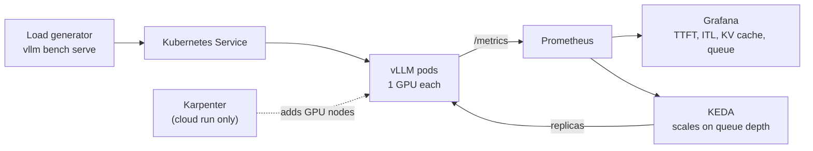

# llm-inference-platform

Production-style LLM serving on Kubernetes with vLLM: autoscaling on queue depth, real observability, and published latency and cost benchmarks.

Built by an infrastructure and security engineer, as a secure, observable, production-grade AI serving platform you can reproduce with one command.

**Status:** Week 1 of 5. vLLM is serving on a local GPU; Kubernetes comes in week 2. Built in public; progress is logged below.

## Why this exists

Most LLM serving demos stop at `vllm serve` on one GPU. Production serving is an infrastructure problem: scheduling GPUs, scaling on the right signal, knowing when users are waiting, and knowing what each token costs. This project treats LLM inference like any other production service, with reproducible infrastructure, metrics that matter and honest benchmarks.

## Approach: local first, cloud once

- **Weeks 1–4, local:** an RTX 5080 Laptop GPU (16 GB) under WSL2, running k3s, the same Helm chart and the same monitoring stack. Free iteration on real hardware.
- **Weeks 4–5, cloud:** one short Terraform-provisioned run on AWS EKS with an NVIDIA L4, using the **same Helm chart**. It proves portability and node autoscaling, and it gives a measured cost per 1M tokens.
- **Model:** [Qwen3-8B-FP8](https://huggingface.co/Qwen/Qwen3-8B-FP8) (Apache-2.0) as the primary model, and Qwen3-1.7B for fast iteration.
- **Engine:** vLLM, pinned to an exact release (currently `v0.33.0`).

## Architecture (target)



Scaling is driven by `vllm:num_requests_waiting` (queue depth), not GPU utilisation. A busy GPU is normal; a growing queue is what users feel.

## Roadmap

- [x] vLLM serving an open-weight model on a local GPU (WSL2, RTX 5080 Laptop)
- [x] Qwen3-8B-FP8 serving, with KV-cache capacity measured on 16 GB
- [ ] k3s with GPU access on WSL2 + Helm chart (`make up-local` / `make down-local`)
- [ ] Prometheus/Grafana dashboard: TTFT, inter-token latency, throughput, KV-cache usage, queue depth, GPU utilisation
- [ ] Autoscaling on queue depth with KEDA
- [ ] One AWS EKS run (Terraform, Karpenter, L4): same chart, node autoscaling, cold-start breakdown
- [ ] Benchmark write-up: laptop vs cloud L4, cost per 1M output tokens (cloud)

## Results so far

Baseline smoke test, **not a final benchmark** (one run, no warm-up). Full methodology lands with the write-up.

Hardware: RTX 5080 Laptop GPU (16 GB), Windows 11 + WSL2 (Ubuntu 24.04). Stack: vLLM `v0.33.0` (Docker), NVIDIA Container Toolkit 1.20.1, `--gpu-memory-utilization 0.85`. Workload: random 512 input / 128 output tokens, 100 prompts, concurrency 8.

| | Qwen3-1.7B (BF16) | Qwen3-8B-FP8 |
|---|---|---|
| Max model length | 4,096 | 8,192 |
| Weights in GPU memory | 3.22 GiB | 8.85 GiB |
| KV cache | 9.17 GiB, 85,824 tokens | 2.89 GiB, 21,024 tokens |
| Full-length requests that fit at once | about 21 | 2.57 |
| Throughput | 6.57 req/s, 840.6 output tok/s | 2.92 req/s, 373.8 output tok/s |
| TTFT | median 147.7 ms, p99 405.8 ms | median 308.5 ms, p99 495.8 ms |
| Inter-token latency | median 7.48 ms, p99 29.5 ms | median 17.9 ms, p99 54.5 ms |
| Engine startup (weights cached) | 103 s | 151 s |

The early takeaway: on 16 GB, the 8B model's weights leave under 3 GiB for KV cache, so long-context concurrency, not compute, will be the first wall.

## Planned layout

```
├── Makefile                 # up-local, down-local, up-cloud, down-cloud, bench
├── infra/terraform/         # VPC, EKS, Karpenter, IAM, S3 (cloud run)
├── charts/vllm/             # Helm chart: values-local.yaml, values-cloud.yaml
├── platform/                # k3s + WSL2 GPU setup, monitoring values
├── observability/           # Grafana dashboards, alert rules
├── bench/                   # benchmark runner + raw results (never edited by hand)
└── docs/                    # architecture, decision records
```

## Progress log

- **2026-11-09:** vLLM `v0.33.0` serving Qwen3-1.7B and Qwen3-8B-FP8 on the RTX 5080 Laptop GPU in WSL2. Blackwell (SM_120) works out of the box, including native FP8 kernels. Cold starts are dominated by weight download (12.9 min for 1.7B, 33 min for 8B on a home connection), which is why the platform caches weights. Baseline benchmarks above.
- **2026-11-08:** Repo created.

## License

Apache-2.0
