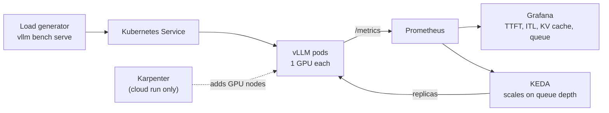

# llm-inference-platform

Production-style LLM serving on Kubernetes with vLLM: autoscaling on queue depth, real observability, and published latency and cost benchmarks.

Built by an infrastructure and security engineer, as a secure, observable, production-grade AI serving platform you can reproduce with one command.

**Status:** Week 1 of 3. vLLM is serving on a local GPU; Kubernetes comes in week 2. Built in public; progress is logged below.

## Why this exists

Most LLM serving demos stop at `vllm serve` on one GPU. Production serving is an infrastructure problem: scheduling GPUs, scaling on the right signal, knowing when users are waiting, and knowing what each token costs. This project treats LLM inference like any other production service, with reproducible infrastructure, metrics that matter and honest benchmarks.

## Approach: local first, cloud once

- **Weeks 1–2, local:** an RTX 5080 Laptop GPU (16 GB) under WSL2, running k3s, the same Helm chart and the same monitoring stack. Free iteration on real hardware.
- **Weeks 2–3, cloud:** one short Terraform-provisioned run on AWS EKS with an NVIDIA L4, using the **same Helm chart**. It proves portability and node autoscaling, and it gives a measured cost per 1M tokens.
- **Model:** [Qwen3-8B-FP8](https://huggingface.co/Qwen/Qwen3-8B-FP8) (Apache-2.0) as the primary model, and Qwen3-1.7B for fast iteration.
- **Engine:** vLLM, pinned to an exact release (currently `v0.33.0`).

## Architecture (target)



Scaling is driven by `vllm:num_requests_waiting` (queue depth), not GPU utilisation. A busy GPU is normal; a growing queue is what users feel.

## Run it today

What works right now is vLLM in Docker on a single NVIDIA GPU. Prerequisites: WSL2 (Ubuntu 24.04) or Linux, Docker Engine and the NVIDIA Container Toolkit.

```bash
# Serve Qwen3-8B-FP8 (the first run downloads about 9 GB of weights into ~/.cache/huggingface)
docker run --rm --gpus all --ipc=host -p 8000:8000 \
  -v ~/.cache/huggingface:/root/.cache/huggingface \
  -v ~/.cache/vllm:/root/.cache/vllm \
  vllm/vllm-openai:v0.33.0 \
  --model Qwen/Qwen3-8B-FP8 --max-model-len 8192 --gpu-memory-utilization 0.85

# Once the weights are cached, add -e HF_HUB_OFFLINE=1 after --ipc=host to skip Hugging Face network checks.

# Check it answers
curl -s localhost:8000/v1/chat/completions -H "Content-Type: application/json" \
  -d '{"model":"Qwen/Qwen3-8B-FP8","messages":[{"role":"user","content":"Hello"}],"chat_template_kwargs":{"enable_thinking":false}}'

# Load test (from a second terminal)
docker exec -it $(docker ps -q --filter ancestor=vllm/vllm-openai:v0.33.0) vllm bench serve \
  --model Qwen/Qwen3-8B-FP8 --dataset-name random --random-input-len 512 --random-output-len 128 \
  --num-prompts 100 --max-concurrency 8

# Measure cold start (starts and stops its own container)
OFFLINE=1 bench/coldstart.sh my-run Qwen/Qwen3-8B-FP8 --max-model-len 8192 --gpu-memory-utilization 0.85
```

## Roadmap

- [x] vLLM serving an open-weight model on a local GPU (WSL2, RTX 5080 Laptop)
- [x] Qwen3-8B-FP8 serving, with KV-cache capacity measured on 16 GB
- [x] k3s with GPU access on WSL2 + Helm chart (planned: `make up-local` / `make down-local`)
- [ ] Prometheus/Grafana dashboard: TTFT, inter-token latency, throughput, KV-cache usage, queue depth, GPU utilisation
- [ ] Autoscaling on queue depth with KEDA
- [ ] One AWS EKS run (Terraform, Karpenter, L4): same chart, node autoscaling, cold-start breakdown
- [ ] Benchmark write-up: laptop vs cloud L4, cost per 1M output tokens (cloud)

## Results so far

Baseline smoke test, **not a final benchmark** (one run, no warm-up). Full methodology lands with the write-up.

Hardware: RTX 5080 Laptop GPU (16 GB), Windows 11 + WSL2 (Ubuntu 24.04). Stack: vLLM `v0.33.0` (Docker), NVIDIA Container Toolkit 1.20.1, `--gpu-memory-utilization 0.85`. Workload: random 512 input / 128 output tokens, 100 prompts, concurrency 8.

| | Qwen3-1.7B (BF16) | Qwen3-8B-FP8 |
|---|---|---|
| Max model length | 4,096 | 8,192 |
| Weights in GPU memory | 3.22 GiB | 8.85 GiB |
| KV cache | 9.17 GiB, 85,824 tokens | 2.89 GiB, 21,024 tokens |
| Full-length requests that fit at once | about 21 | 2.57 |
| Throughput | 6.57 req/s, 840.6 output tok/s | 2.92 req/s, 373.8 output tok/s |
| TTFT | median 147.7 ms, p99 405.8 ms | median 308.5 ms, p99 495.8 ms |
| Inter-token latency | median 7.48 ms, p99 29.5 ms | median 17.9 ms, p99 54.5 ms |
| vLLM engine init, first start (vLLM's internal timer) | 103 s | 151 s |

The early takeaway: on 16 GB, the 8B model's weights leave under 3 GiB for KV cache, so long-context concurrency, not compute, will be the first wall.

Engine init is vLLM's own timer for memory profiling, KV-cache allocation and warm-up. It excludes container start, weight download and loading, and API server start, so it is shorter than the wall-clock "ready" times in the cold-start table below, which come from separate runs on 10 Nov.

### Cold start (Qwen3-8B-FP8): 35 minutes to about 2.3 minutes

Measured with [`bench/coldstart.sh`](bench/coldstart.sh): wall-clock time from `docker run` until `/health` returns 200, Qwen3-8B-FP8, same flags every run. Raw logs and `results.jsonl` are in [`bench/results/coldstart/`](bench/results/coldstart/). For comparison, the smaller Qwen3-1.7B took about 14.5 min on its first start, 12.9 min of it weight download (9 Nov log).

| Run | Ready | Weight download | Weight load | torch.compile | Engine init |
|---|---|---|---|---|---|
| First start, nothing cached (Qwen3-8B-FP8, 9 Nov log, approximate) | about 35 min | 1,981 s | 1.3 s | 20.7 s | 151 s |
| Weights cached on local disk | 212 s | none | 5.2 s | 21.2 s | 147 s |
| + offline mode (`HF_HUB_OFFLINE=1`), compile cache filling | 153 s | none | 1.5 s | 21.0 s | 116 s |
| + compile cache hit (run 1) | **135 s** | none | 1.2 s | 0.16 s | 95 s |
| + compile cache hit (run 2) | **145 s** | none | 5.0 s | 0.17 s | 93 s |

What changed:

- **Weights cached on local disk** (`~/.cache/huggingface` mounted into the container) removed the download, which was 95% of the original cold start.
- **Compile cache persisted** (`~/.cache/vllm` mounted) cut torch.compile from 21 s to under 0.2 s. It hit on the second offline run, not the first, which suggests the offline setting is part of the cache key.
- **What remains (about 93 s)** is engine initialisation, mostly CUDA graph capture, which is not cached. In production that floor is handled with warm replicas or fewer captured graph sizes.

Side finding: with the compile cache hit, vLLM's startup memory profiling measured a lower peak activation (0.92 GiB instead of 1.58 GiB), so the KV cache grew from 21,024 to 25,824 tokens with identical flags and identical free memory (14.61 GiB). Capacity can change between restarts, so benchmarks will pin `--kv-cache-memory` explicitly.

## Planned layout (not built yet)

Only `bench/` exists today; the rest arrives with the milestones above.

```
├── Makefile                 # planned: up-local, down-local, up-cloud, down-cloud, bench
├── infra/terraform/         # VPC, EKS, Karpenter, IAM, S3 (cloud run)
├── charts/vllm/             # Helm chart: values-local.yaml, values-cloud.yaml
├── platform/                # k3s + WSL2 GPU setup, monitoring values
├── observability/           # Grafana dashboards, alert rules
├── bench/                   # benchmark runner + raw results (never edited by hand)
└── docs/                    # architecture, decision records
```

## Progress log

- **11 Nov:** vLLM serving on k3s (WSL2) with the GPU scheduled by the NVIDIA device plugin; fixed a VLLM_PORT service-link crash.
- **2026-11-10:** Cold start for Qwen3-8B-FP8 cut from about 35 min to 135–145 s by caching weights locally, persisting vLLM's compile cache and running Hugging Face offline. Measured with `bench/coldstart.sh`; remaining time is CUDA graph capture.
- **2026-11-09:** vLLM `v0.33.0` serving Qwen3-1.7B and Qwen3-8B-FP8 on the RTX 5080 Laptop GPU in WSL2. Blackwell (SM_120) works out of the box, including native FP8 kernels. Cold starts are dominated by weight download (12.9 min for 1.7B, 33 min for 8B on a home connection), which is why the platform caches weights. Baseline benchmarks above.
- **2026-11-08:** Repo created.

## License

Apache-2.0
