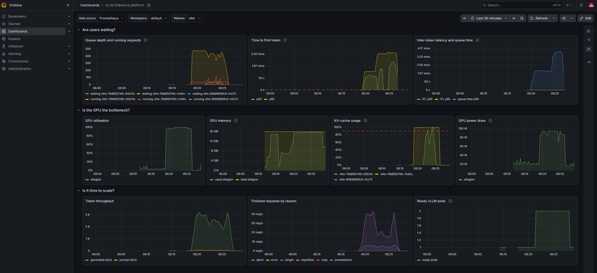

# Autoscaling on queue depth (KEDA)

vLLM scales out when requests start waiting, not on GPU utilisation. In the 512-request alert
test the queue is what tracked user pain: p95 time to first token went from about 40 ms
(8 concurrent) to about 38 s (512 concurrent), almost all of it time spent waiting.

```bash
make keda-up        # KEDA 2.21.1, namespace "keda" (once)
make device-plugin  # time-slicing: the node advertises nvidia.com/gpu: 2 (also part of up-local)
make up-local       # adds the ScaledObject; vLLM restarts once with the 2-replica memory budget
make scale-test     # 6 min of load, then watch it scale back (about 10 min in all)
```

## How it fits on one 16 GB GPU

| Piece | Setting | Why |
|---|---|---|
| Device plugin | time-slicing, `replicas: 2` ([`10-nvidia-device-plugin.yaml`](../k3s/10-nvidia-device-plugin.yaml)) | Two pods can each request `nvidia.com/gpu: 1`. No memory isolation: each pod has to stay inside its own budget. |
| vLLM memory | `--gpu-memory-utilization 0.4`, `--kv-cache-memory` 1.5 GiB ([`values-local.yaml`](../../charts/vllm/values-local.yaml)) | vLLM v0.33.0 refuses to start unless `utilization x total` is free, even with a pinned KV cache. 0.4 leaves room for the second pod next to Windows' ~1.5 GB. |
| ScaledObject | `sum(vllm:num_requests_waiting)`, threshold 5 per replica, 1-2 replicas ([`scaledobject.yaml`](../../charts/vllm/templates/scaledobject.yaml)) | Scale up immediately; scale down once the queue has stayed low for the 120 s HPA stabilisation window. |
| Alert | `VLLMOutOfCapacity` follows the same threshold and max | Fires only when KEDA has nothing left to add. |

`scale-test` runs the load as an in-cluster Job against the Service, so both replicas get
traffic (a port-forward would pin everything to one pod), and prints replicas, waiting and running
requests every 10 s. Keep `make grafana` open on the "vLLM inference platform" dashboard for the graph.

## Result (17 Nov 2026)

Raw output: [`bench/results/autoscaling/20261117T0248Z-scale-test.log`](../../bench/results/autoscaling/20261117T0248Z-scale-test.log).

| Step | Time (UTC) | After |
|---|---|---|
| Load starts (512 concurrent) | 02:48:51 | |
| KEDA asks for 2 replicas | 02:49:03 | 12 s |
| Second pod Ready | 02:51:37 | about 2.5 min |
| Queue empty | 02:56:21 | |
| Back to 1 replica | 02:58:11 | about 2 min (HPA stabilisation window) |



The second replica did not raise throughput: the shared GPU was already at 100% and each pod's
1.5 GiB KV cache filled (preemptions on the dashboard). On one GPU this proves the scaling loop,
not capacity; capacity needs a second GPU node (the EKS run with Karpenter).
